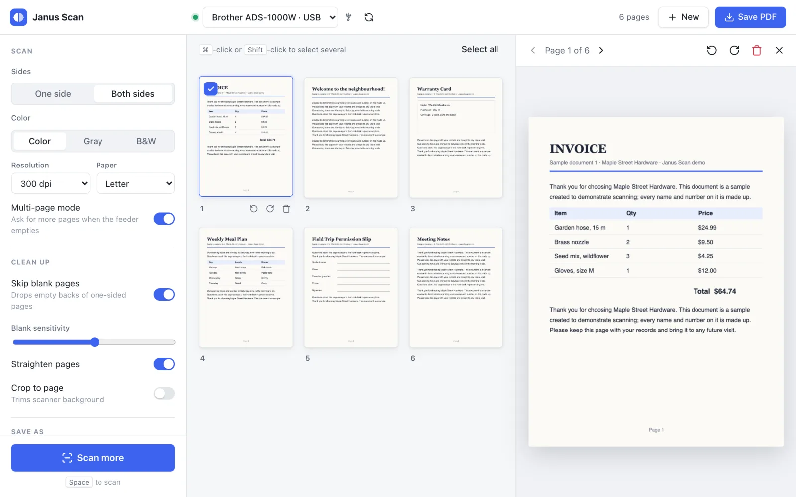
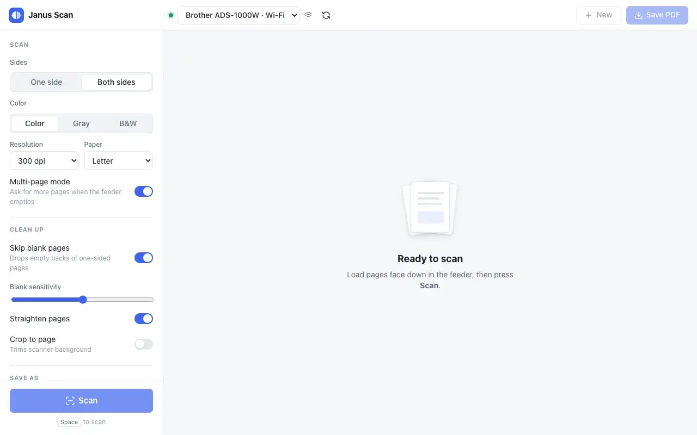
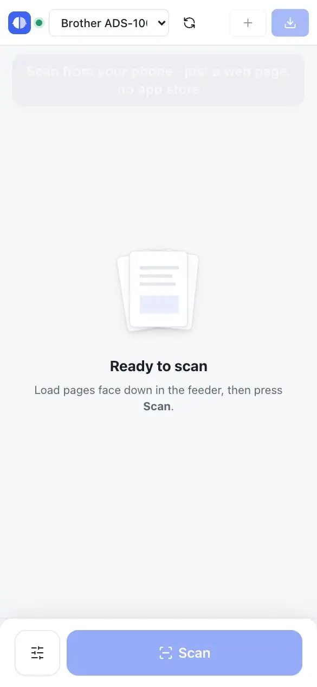
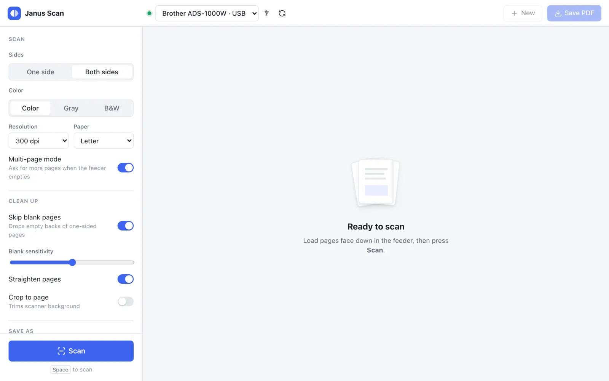
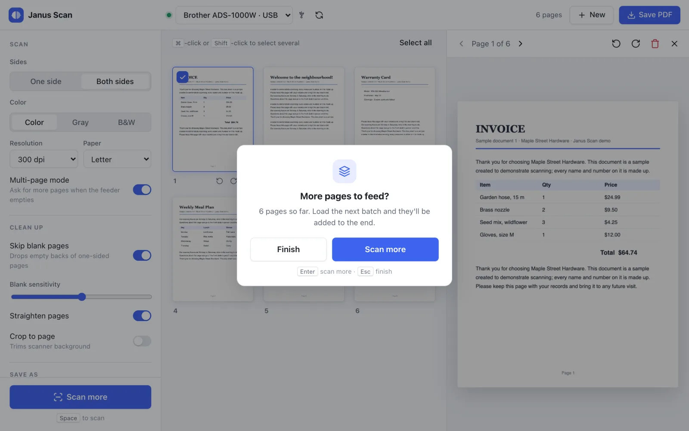

<div align="center">


# Janus Scan

**A simple, private scanning app for the Brother ADS-1000W, on macOS, Linux and any phone.**

One or both sides · multi-page batches · PDF, JPEG, PNG or TIFF · USB and Wi-Fi · scan from your phone

<picture>
  <source media="(prefers-color-scheme: dark)" srcset="docs/screenshots/scanned-dark.webp">
  
</picture>

</div>

> [!NOTE]
> **Built and tested on one scanner: the Brother ADS-1000W.** Nothing in the code is tied to it, so other scanners with a Linux SANE driver or a macOS ICA driver may well work, but I can only test what I own. Pull requests that add or fix support for other models are welcome, tested on the real scanner. If you'd like me to support a model myself, I'm happy to work on one you can donate or lend: open an issue. [Other scanner models](docs/design.md#other-scanner-models) lists what's likely to need changing.

## Why

The ADS-1000W is a great little sheet-fed scanner, but its software is Windows-first. On a Mac or Linux PC you're left with generic tools that make simple things hard: choosing PDF or JPEG, choosing one side or both, or carrying on when the feeder runs out of paper. Janus Scan puts all of that on one screen, and with Janus Scan Server, on every phone in the house.

It's named after its author, and the Roman god Janus, with his two faces looking both ways, made it an easy choice for a scanner that reads both sides of every sheet. His two faces are the logo.

## See it in action

<table>
<tr>
<td width="72%" valign="top">

**On a computer**



</td>
<td width="28%" valign="top">

**On a phone**



</td>
</tr>
</table>

## What you get

What Janus Scan adds on a Mac, on Linux and on phones. Brother's own software, which is best on Windows, isn't a target: Janus Scan doesn't run on Windows.

| | |
| --- | --- |
| **A real app on Linux** | Brother's Linux downloads for the ADS-1000W are a scanner driver only, with no app. Janus Scan is a full app on Ubuntu, Linux Mint, Linux Lite and CachyOS, as well as macOS. |
| **Scan from any phone** | Janus Scan Server runs next to the scanner; phones, tablets and other computers scan by opening a web page, with no app store and no driver. Over HTTPS it installs to the home screen and opens like an app. The layout is built for phones: a big Scan button, two-column pages, settings in a bottom sheet. |
| **One document, every device** | Start on the phone, finish on the laptop: every open browser sees the same pages, live. |
| **Fix pages before saving** | Reorder by dragging (long-press on a phone), rotate any single page, remove pages, and keep adding batches when the feeder runs out. |
| **Less clean-up** | Switches to skip the blank backs of one-sided pages, straighten crooked pages and crop away the scanner background. |
| **Save where the files belong** | A NAS folder (NFS or SMB) with its own file name preset, like `Receipts {date} {n}`, or a download to the device. |
| **Faster over Wi-Fi** | 2.2 s per page side through Janus Scan Server, against 10.1 s with Brother's macOS driver (color, 300 dpi, both sides). Over USB both run at the scanner's own speed, about 2 s; the macOS app uses Brother's driver, so on a Mac, use USB for long documents. |
| **Small** | The macOS app is a 2.8 MB disk image (5.2 MB installed, Apple Silicon) and the Linux app a 2.8 MB `.deb` (6.8 MB installed). The server is a 31 MB container image. The apps are native code (Rust) using the system's web view, not a bundled browser. |
| **Runs where you do** | Desktop app on macOS and Linux; the server under Docker Compose, Kubernetes (Helm chart) or LXC (Proxmox). |
| **Private** | No account, no telemetry, no cloud. Pages in progress live in a private temporary folder and are deleted afterwards; the server removes unsaved pages after an hour without activity. |
| **Open source** | [MIT licensed](LICENSE). |

## Features

<table>
<tr>
<td width="50%" valign="top">

**Everything on one screen**

Sides, color, resolution, paper size, clean-up and file type, all in the sidebar. Press Space to scan.

</td>
<td width="50%" valign="top">

**Multi-page batches**

When the feeder runs empty, Janus Scan asks whether you have more pages and adds them to the same document.

</td>
</tr>
<tr>
<td>

<picture>
  <source media="(prefers-color-scheme: dark)" srcset="docs/screenshots/main-dark.webp">
  
</picture>

</td>
<td>

<picture>
  <source media="(prefers-color-scheme: dark)" srcset="docs/screenshots/more-pages-dark.webp">
  
</picture>

</td>
</tr>
</table>

| | |
| --- | --- |
| **Scanning** | One or both sides in a single pass · color, gray or black & white · 100–600 dpi · Letter, Legal, A4, A5, business card, receipt |
| **Pages** | Live thumbnails and a large preview · drag to reorder · rotate · select several or all, then remove |
| **Clean-up** | Skip blank pages · straighten crooked pages · crop to the page |
| **Saving** | Multi-page PDF, JPEG, PNG or TIFF · never overwrites an existing file |
| **File name preset** | Set once in the sidebar under *Save as*: any text plus `{date}` (YYYY-MM-DD), `{time}` (HHMMSS) and `{n}` (next free number: 001, 002, …). `Receipts {date} {n}` gives `Receipts 2026-10-17 001.pdf`. Default: `Scan {date} {time}`. |
| **Connections** | USB and Wi-Fi, found automatically |
| **Comfort** | Light and dark mode · keyboard shortcuts · remembers your settings |
| **Privacy** | Everything stays on your computer: no accounts, no telemetry, no cloud. Pages in progress live in a private temporary folder that is deleted afterwards. |

## Status

| Platform | USB | Wi-Fi |
| --- | --- | --- |
| macOS | ✅ Working | ✅ Working |
| Linux (Ubuntu, Linux Mint, Linux Lite, CachyOS) | ✅ Working (tested on Linux Mint and Linux Lite) | ✅ Working (tested on Linux Mint and Linux Lite) |
| Janus Scan Server (Docker, Kubernetes, LXC) | Not used: Wi-Fi only | ✅ Working (tested with Docker and on a k3s cluster, 2.2 s per page side) |

> [!TIP]
> **On a Mac, use USB for long documents.** In measured runs (color, 300 dpi, both sides), USB took 2.0 s per page side and Wi-Fi 10.1 s. Brother's macOS driver is the bottleneck: on Linux, Brother's driver over the same Wi-Fi took 3.2 s per page side.

## Install

### 1. Brother's scanner driver

- **macOS:** the ADS-1000W scanner driver (the "ICA" driver) from [support.brother.com](https://support.brother.com). After installing it, the scanner should appear in Apple's Image Capture app.
- **Linux:** `brscan4` for the ADS-1000W from [support.brother.com](https://support.brother.com) (64-bit x86 PCs only). On Ubuntu, Mint and Lite, install the `.deb` with `sudo dpkg -i brscan4-*.amd64.deb`; on CachyOS, install `brscan4` from the AUR (`yay -S brscan4` or `paru -S brscan4`), which downloads Brother's `.rpm` and repackages it for Arch. For Wi-Fi, register the scanner once:

  ```sh
  sudo brsaneconfig4 -a name=ADS1000W model=ADS-1000W ip=<scanner IP>
  ```

To put the scanner on your Wi-Fi without Brother's Windows tool, see [Wi-Fi setup](docs/wifi-setup.md).

Supported Linux versions: Ubuntu 24.04 or newer, Linux Mint 22 or newer, Linux Lite 7 or newer, and CachyOS. Releases built on Ubuntu 22.04 or older aren't supported.

### 2. Janus Scan: a package or your own build

**From a package**, when a release includes them:

- **macOS** (`.dmg`): drag Janus Scan to Applications. The app isn't signed with a paid Apple developer ID, so macOS blocks it the first time: open it once, then go to **System Settings → Privacy & Security** and click **Open Anyway**. After that it opens normally. If you'd rather not, build it yourself (below); your own build opens without the prompt.
- **Ubuntu, Linux Mint, Linux Lite** (`.deb`): `sudo apt install ./janus-scan_<version>_amd64.deb` installs it with the libraries it needs.
- **CachyOS** (Arch package): `sudo pacman -U janus-scan-<version>-1-x86_64.pkg.tar.zst` installs it with the libraries it needs; Brother's `brscan4` comes from the AUR.

**Or build it yourself**, as below.

### 3. Rust and Node.js

You need [Rust](https://rustup.rs) 1.85 or newer and [Node.js](https://nodejs.org) 20.19 or newer. Install them with rustup and nvm. Don't use your Linux distro's `cargo`, `rustc` or `nodejs` packages; on Ubuntu, Mint and Lite they're too old.

```sh
curl --proto '=https' --tlsv1.2 -sSf https://sh.rustup.rs | sh
. "$HOME/.cargo/env"

curl -o- https://raw.githubusercontent.com/nvm-sh/nvm/v0.40.1/install.sh | bash
. "$HOME/.nvm/nvm.sh"
nvm install 22
```

### 4. Build and install Janus Scan

```sh
sh scripts/install.sh
```

The script checks Rust and Node, installs the Linux system packages it needs (asking for your password), builds the app and installs it:

- **macOS:** into Applications. Open it from Launchpad or Spotlight.
- **Ubuntu, Linux Mint, Linux Lite:** as a `.deb` package. Find it in the app menu under Graphics.
- **CachyOS:** as an AppImage in `~/.local/bin` with an app menu entry under Graphics.

The first build compiles the whole app and takes a while, longest on older PCs. To update, get the new code and run the script again. To remove the app, run `sh scripts/install.sh --uninstall`.

## Development

```sh
cd app
npm install          # no package names after it
npm run tauri dev    # run the app with live reload
```

On Linux, run `sudo sh scripts/linux-deps.sh` first to install the system packages.

### Linux packages

`sh scripts/package-linux.sh` builds the `.deb` and the CachyOS package with Docker, on a Mac or on Linux, into `target/linux-packages/`. The first run compiles everything and takes a while; later runs reuse the compiled code.

### Command-line tool

The same scanning code is available as a command-line tool:

```sh
cargo run --release -p janus-scan-cli -- list
cargo run --release -p janus-scan-cli -- scan --duplex --dpi 300 --multi --out ~/Scans
cargo run --release -p janus-scan-cli -- --help
```

### Janus Scan Server

A web version of the app for phones and other computers on the network: one server drives the scanner through SANE, and any browser scans from it and saves to the device or to NAS folders. On Linux it needs Brother's driver like the desktop app; on a Mac, run it in Docker (below), because Brother has no SANE driver for macOS.

The published image, `ghcr.io/januschung/janus-scan-server`, has everything except Brother's driver, which isn't ours to redistribute. You add the driver on your own machine in a build that takes a few seconds. The result contains Brother's driver, so keep it on your own machines or in a private registry.

**Docker** (any x86-64 host, or a Mac): unpack `janus-scan-server_<version>.tar.gz` from a release (or use [deploy/](deploy) in a clone), put Brother's `brscan4` amd64 `.deb` next to `docker-compose.yml`, list the folders to save to in `server.yaml`, then:

```sh
SCANNER_IP=192.168.1.50 docker compose up -d --build
```

Set `TZ` (for example `TZ=America/Los_Angeles`) so `{date}` and `{time}` in file names use local time; it's UTC otherwise. On a Mac, `TZ=$(readlink /etc/localtime | sed 's#.*zoneinfo/##')` passes the Mac's own time zone. `docker-compose.yml` has NFS and SMB volume examples for NAS shares; the container runs as user 1000, which needs write access to them. To start from an image built from source instead (`docker build --platform linux/amd64 -f deploy/Dockerfile -t janus-scan-server .`), set `JANUS_SCAN_IMAGE=janus-scan-server`.

**Kubernetes:** add the driver, push the result to a private registry, then install the Helm chart (`helm/` in the release download, or [deploy/helm/janus-scan](deploy/helm/janus-scan)):

```sh
docker build --platform linux/amd64 -f driver.Dockerfile -t registry.lan/janus-scan-server .
docker push registry.lan/janus-scan-server
helm install janus-scan ./helm \
  --set image.repository=registry.lan/janus-scan-server --set scanner.ip=192.168.1.50
```

NAS folders go under `destinations` in [values.yaml](deploy/helm/janus-scan/values.yaml), as an NFS share or any existing volume claim. It always runs one copy (the scan lock and the document live in memory); behind ingress-nginx, set the two annotations in `values.yaml` so live updates aren't buffered.

**LXC** (Proxmox and others): no Docker inside; see [deploy/lxc/README.md](deploy/lxc/README.md).

**Without Docker, for development:**

```sh
cd app && npm run build:web && cd ..     # web front end into app/build-web
WEB_DIR=app/build-web cargo run --release -p janus-scan-server
```

Then open `http://<this computer>:8080`. Settings, all optional: `PORT` (8080), `BIND` (0.0.0.0), `JANUS_DEVICE` (a SANE device name from `scanimage -L`; the first one otherwise), `JANUS_CONFIG` (the destinations file, like [deploy/server.yaml](deploy/server.yaml); download only without it), `IDLE_TIMEOUT_MINUTES` (unsaved pages are deleted after this long without activity; 60, or 0 for never), `WEB_DIR` (API only when unset). For front-end work, run the server and `npm run dev:web` in `app/`; Vite forwards `/api` to the server (`JANUS_SERVER` sets another address).

Installing it to the home screen ("Add to Home screen" on Android) needs HTTPS, for example through `tailscale serve`; over plain `http://` the page works in the browser but can't be installed.

## Troubleshooting

| Problem | Fix |
| --- | --- |
| `failed to run 'cargo metadata'` | The terminal can't find Rust. Run `. "$HOME/.cargo/env"` or open a new terminal. |
| `` `resolver` setting `3` is not valid `` | Rust is too old, usually the distro's `cargo` package. Remove it (`sudo apt remove cargo rustc`) and install Rust with rustup. |
| npm errors mentioning `node-gyp`, or Vite refusing to start | Node is too old. Install Node 22 with nvm. |
| `The system library gdk-3.0 ... was not found` | Linux system packages are missing. Run `sudo sh scripts/linux-deps.sh`. |
| Pressing the Scan button on the scanner beeps three times | Expected: Janus Scan doesn't use the scanner's own button (Brother has no Linux scan-key tool for the ADS-1000W), so the scanner has nowhere to send the pages. Start scans from the app. |
| The scanner doesn't show up | Check that Brother's driver sees it: Image Capture on macOS, `scanimage -L` on Linux. |
| On Linux, `scanimage -L` lists the USB scanner only with `sudo` | Your user can't access the USB device. Install Brother's udev rule package from support.brother.com, then unplug and replug the scanner. |
| On Linux, the window is blank or flickers (some NVIDIA + Wayland setups) | Start it with `WEBKIT_DISABLE_DMABUF_RENDERER=1`. |

To report a Linux problem, run `sh scripts/linux-check.sh` and attach the `linux-check-report.txt` it writes. It holds versions, device names and timings, never scanned pages.

## Project layout

| Path | What it is |
| --- | --- |
| `crates/scan-core` | Shared scanner interface used by everything else |
| `crates/backend-ica` | macOS scanning through Apple's ImageCaptureCore |
| `crates/backend-sane` | Linux scanning through SANE |
| `crates/imaging` | Thumbnails, blank-page detection, straightening, cropping |
| `crates/export` | PDF, JPEG, PNG and TIFF writers |
| `crates/document` | The document being assembled, kept in a private temporary folder (app and server) |
| `crates/server` | Janus Scan Server: the web API, and the web front end from `app/build-web` |
| `crates/cli` | The `janus-scan` command-line tool |
| `app` | The desktop app (Tauri 2 + Svelte); `npm run build:web` builds the same UI for the server |
| `docker` | Linux build and test images |
| `deploy` | Janus Scan Server: Docker image and Compose file, Helm chart, LXC install files, example config |
| `docs` | [Wi-Fi setup](docs/wifi-setup.md), [design notes](docs/design.md), screenshots |
| `packaging` | Arch package recipe for CachyOS (built by `scripts/package-linux.sh`) |
| `scripts` | `install.sh` (build and install), `linux-deps.sh` (Linux system packages), `linux-check.sh` (Linux diagnostics report) |

[docs/design.md](docs/design.md) has the design notes, what we learned about Brother's drivers, and what's left to do.

## License

[MIT](LICENSE). Brother's scanner driver isn't part of Janus Scan: it's Brother's software under Brother's own license, downloaded separately.

## Trademarks

Janus Scan is an independent project. It is not affiliated with, endorsed by, or sponsored by Brother Industries, Ltd. "Brother" and "ADS-1000W" are trademarks of their owner and are used here only to say which scanner this app works with.
